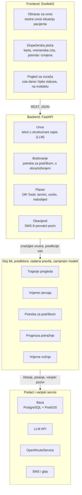

# Sustav za planiranje prijevoza pacijenata — arhitektura

Stanje: 13. 11. 2026. · Izazov 20 (AI2MED): Kako olakšati fizički pristup zdravstvenim uslugama?

## 1. Pregled

Sustav organizira prijevoz od vrata do vrata za pacijente koji sami ne mogu doći na zdravstveni pregled, a pacijentu je za to dovoljan jedan telefonski poziv. Ne pretpostavlja se automobil, pametni telefon ni osoba koja može pomoći.

Medicinska sestra u timu obiteljske medicine ili dispečer sanitetskog prijevoza u županijskom zavodu za hitnu medicinu unosi situaciju pacijenta, sustav zajedno predlaže termin i prijevoz, a pacijent plan dobiva SMS-om, povratnim pozivom ili na papiru.

Načela:

- **Telefon na prvom mjestu.** Svaki korak prema pacijentu radi preko fiksne linije ili SMS-a.
- **Termin i prijevoz rješavaju se zajedno.** Termin se može pomaknuti da odgovara prijevozu, a pacijenti iz istog područja se grupiraju.
- **Odlučuje solver, jezični modeli prevode.** Raspoređivanje je optimizacija s ograničenjima; LLM samo pretvara govor u strukturirane podatke i plan u jednostavan hrvatski.
- **Procjene samo dodaju pomoć.** Nijedna predikcija ne služi za otkazivanje, odbijanje ili niži prioritet pacijenta.
- **Zadnju riječ ima sestra.** Svaki plan je prijedlog koji se potvrđuje ili mijenja.
- **ML je zamjenjiv.** Svaka prediktivna komponenta ima isto sučelje i zadano pravilo, pa sustav radi i bez ijednog istreniranog modela.
- **Samo za Hrvatsku.** Uloge, prava, identifikatori, jezik i ustanove prate hrvatski javni zdravstveni sustav.

## 2. Hrvatski kontekst

Sustav stoji između ordinacije obiteljske medicine, doma zdravlja i bolnice, i služi pacijentima koje postojeća prava HZZO-a ne pokrivaju.

### Uloge

| Uloga | Gdje | U sustavu |
| --- | --- | --- |
| Izabrani liječnik obiteljske medicine | Ordinacija u domu zdravlja ili privatna ugovorna ordinacija | Izdaje eUputnicu i naloge za prijevoz; odobrava plan kad je potreban nalog |
| Medicinska sestra u timu obiteljske medicine | Ista ordinacija | Glavni korisnik unosa: prima poziv, unosi zahtjev i priprema podatke za nalog |
| Patronažna sestra | Dom zdravlja | Zna tko živi sam; unosi zahtjeve iz kućnih posjeta |
| Dispečer sanitetskog prijevoza | Županijski zavod za hitnu medicinu (u Ličko-senjskoj županiji Zavod je sanitetski prijevoz preuzeo 2024., s ispostavama u Gospiću, Otočcu, Senju, Korenici i Novalji) | Korisnik planera za sanitetska vozila |
| Jedinica za centralno naručivanje (bolnički šalter) | Opća bolnica, KBC, poliklinika | Otvara termine za eNaručivanje, odgovara na zahtjeve za termin i naručuje kontrolne preglede |
| Lokalni partneri | Crveni križ, općina ili grad, volonteri | Daju vozila za pacijente bez prava iz HZZO-a |
| Pacijent-vozač | Pacijent koji na pregled ide vlastitim autom | Uz privolu poveze sumještane koji idu u istu ustanovu isti dan |

### Što već postoji i gdje je praznina

- **Uputnica i naručivanje.** Izabrani liječnik izdaje eUputnicu i naručuje kroz eNaručivanje, traži termin od ustanove ili se pacijent naručuje sam s MBO-om. Bolnice i primarna zaštita povezane su kroz CEZIH. ([Dnevnik.hr](https://dnevnik.hr/vijesti/hrvatska/hzzo-umjesto-papirnatih-od-danas-euputnice---622465.html))
- **Sanitetski prijevoz.** HZZO ga priznaje samo osiguranim osobama koje su nepokretne, teško pokretne ili im se ne preporučuje samostalno kretanje, na temelju naloga. ([HZZO](https://hzzo.hr/wp-content/uploads/2014/01/PUTNI_TROSAK-ISL.pdf), [Pravilnik](https://www.zakon.hr/cms.htm?id=7708))
- **Putni nalog.** Pacijent koji nema pravo na sanitetski prijevoz, a upućen je najbližoj ugovornoj ustanovi s tom djelatnošću udaljenoj 50 i više km od adrese, dobiva naknadu od 0,025 % proračunske osnovice po kilometru (oko 0,11 €), za bilo koje prijevozno sredstvo. Od 1. 8. 2025. udaljenost se mjeri najkraćom cestovnom relacijom prema karti HAK-a. Bez obzira na udaljenost pravo imaju, među ostalima, osobe do 18 godina te pacijenti na hemodijalizi, kemoterapiji i radioterapiji. Nalog izdaje izabrani liječnik. Dijaliza ili kemoterapija sama po sebi ne daje pravo na sanitetski prijevoz. Pravila za sustav su u `data/domain/hzzo_rules.yaml`. ([ZOZO, izmjene 2025.](https://sabor.hr/sites/default/files/uploads/sabor/2025-06-27/154502/PZ_148.pdf), [VUS Usoz-264/2023](https://sudovi.hr/sites/default/files/dokumenti/2025-05/Usoz-264-2023-O-A.pdf))
- **Opterećenje sanitetskog prijevoza.** Javni izvori ne pokazuju slobodan kapacitet: u Splitu se u pojedine dane uključuju rezervna vozila hitne, a sanitetski prijevoz sve više koriste pokretne osobe kojima liječnici naloge izdaju i iz socijalnih razloga ([Dnevnik.hr](https://dnevnik.hr/vijesti/hrvatska/split-prijeti-kolaps-zbog-velikog-porasta-sanitetskog-prijevoza-pacijenata---575245.html)). Sustav zato ne računa na višak sanitetskih vozila, nego ih rasterećuje preusmjeravanjem pokretnih pacijenata na druge oblike prijevoza.
- **Praznina.** Osoba koja može hodati, ali nema autobusnu liniju, automobil ni pomagača, ne dobiva sanitetski prijevoz, a naknada ne vrijedi ništa tamo gdje javnog prijevoza nema. Ta skupina je glavna ciljna skupina sustava.

### Pravila lokalizacije

- Sučelje, poruke pacijentima i glas isključivo na hrvatskom; datumi, vrijeme i praznici po hrvatskom kalendaru, vremenska zona Europe/Zagreb.
- Adrese po naselju, općini ili gradu i županiji; zone za grupiranje i prognozu potražnje prate granice općina.
- Pacijent se identificira MBO-om, uputnica referencom eUputnice. U hackathonskoj verziji nema integracije s CEZIH-om: termini su unaprijed uneseni, a podatkovni model čuva ključeve potrebne za kasniju integraciju.
- Ustanove prate hrvatsku mrežu: dom zdravlja na primarnoj razini, opća bolnica i poliklinika na sekundarnoj, KBC na tercijarnoj.

## 3. Komponente sustava

Sustav ima četiri sloja: SvelteKit frontend, FastAPI backend s četiri modula, sloj ML prediktora te podatke i vanjske servise.



Frontend razgovara samo s backendom. Moduli backenda traže procjene od sloja prediktora i nikad ne zovu model izravno; zato se pravilo može zamijeniti istreniranim modelom bez izmjene planera.

| Sloj | Tehnologija | Napomene |
| --- | --- | --- |
| Frontend | SvelteKit, samo klijent; biblioteka za karte, npr. Leaflet | Tri pogleda: obrazac za unos, dispečerska ploča i mobilni pogled za vozača |
| Backend | FastAPI, Pydantic | Moduli: unos, bodovanje, planer, obavijesti |
| Planer | Google OR-Tools (routing) | Radi u istom procesu; rješavanje s vremenskim ograničenjem |
| ML sloj | scikit-learn ili LightGBM, SHAP | Modeli kao verzionirane datoteke, učitavaju se pri pokretanju |
| Baza | PostgreSQL s PostGIS-om, lokalno u Dockeru | Pristup kroz SQLAlchemy i GeoAlchemy2; koordinate kao prostorni stupci, granice općina kao poligoni; čuva i TripLog te zapise predikcija |
| Vanjski servisi | LLM, OpenRouteService, SMS i glasovni pristupnik | Svaki iza tankog adaptera da se može lažirati (mock). LLM: otvoreni model iz obitelji Qwen. Tim nema GPU, pa se za demo koristi preko API-ja pružatelja, a mali Qwen lokalno na procesoru je rezerva bez mreže; u produkciji isti model na poslužitelju u EU ili u ustanovi, bez promjene koda |

## 4. Podatkovni model

Šest entiteta nosi cijeli sustav; sve što trebaju solver i modeli je stupac na jednom od njih.

| Entitet | Ključna polja | Tko upisuje |
| --- | --- | --- |
| Pacijent | ime, MBO, telefon i vrsta telefona, adresa + geokod, naselje, općina i županija, klasa pokretljivosti (hoda, štap, kolica, nosila), živi sam, pratnja, kat i lift, pravo na prijevoz (sanitetski prijevoz, putni nalog, ništa), vlastiti auto, spremnost da poveze druge i broj slobodnih mjesta, privola za zajedničku vožnju | Unos |
| Zahtjev za pregled | pacijent, referenca eUputnice, ustanova, djelatnost, vrsta pregleda, klasa hitnosti, najraniji i najkasniji datum, ponavljanje, mogući termini | Unos |
| Termin | ustanova, djelatnost, početak, kapacitet | Početni podaci ili bolnički sustav |
| Vozilo | vrsta pružatelja (sanitetski prijevoz županijskog zavoda za hitnu medicinu, Crveni križ, općinski prijevoz, volonter, taksi, pacijent-vozač), sjedala, mjesta za kolica, početak i kraj smjene, baza, telefon vozača | Dispečer |
| Dodjela | zahtjev, termin, vozilo, vrijeme ukrcaja, vrijeme povratnog ukrcaja, status (predloženo, potvrđeno, izmijenjeno, obavljeno) | Planer, sestra |
| TripLog | dodjela, stvarni dolazak pred vrata, polazak, prijava u ustanovi, odjava, iskrcaj | Vozač ili sestra, nakon vožnje |

TripLog je entitet koji kasnije omogućuje ML: svaka obavljena vožnja postaje redak za treniranje modela trajanja pregleda, vremena ukrcaja i vremena vožnje.

## 5. Tok zahtjeva

Jedan zahtjev prolazi pet koraka, od poziva do potvrđene vožnje.

1. **Poziv.** Pacijent zove svoju ordinaciju obiteljske medicine, gdje se izdaje eUputnica. Sestra upisuje u obrazac ili zalijepi bilješke ili transkript. Pacijenta koji ide vlastitim autom pita bi li povezao nekoga iz svog mjesta, a pacijenta bez prijevoza pristaje li na vožnju sa sumještaninom.
2. **Izdvajanje.** Modul unosa šalje slobodni tekst LLM-u i dobiva JSON prema shemama Pacijenta i Zahtjeva. Polja koja nedostaju ili nisu valjana označe se sestri i nikad se ne pogađaju. Adresa se geokodira, a sestra potvrđuje točku na karti.
3. **Bodovanje i procjene.** Modul bodovanja računa potrebu za podrškom s doprinosom svakog faktora. Provjera prava označava ispunjava li pacijent uvjete za sanitetski prijevoz ili putni nalog HZZO-a i priprema podatke za nalog koji izdaje izabrani liječnik. Sloj prediktora vraća trajanje pregleda i vrijeme ukrcaja.
4. **Plan.** Planer rješava sve otvorene zahtjeve za ciljani dan: termin, vozilo, redoslijed ukrcaja, povratak. Vrti se noću za idući dan i ponovno na zahtjev kad se zahtjev doda ili otkaže.
5. **Potvrda i obavijest.** Sestra pregleda plan na ploči, po potrebi ga izmijeni i potvrdi. Modul obavijesti iz fiksnog predloška piše poruku jednostavnim hrvatskim i šalje je SMS-om, automatskim pozivom ili ispisom. Svaka poruka sadrži broj telefona na koji pacijent može dobiti živu osobu.

Nakon potvrde plan dobivaju i vozači: profesionalni vozač link na rutu dana, a pacijent-vozač SMS na koji odgovara "DA" ili "NE". Stvarna vremena vozač upisuje tipkama statusa tijekom vožnje; ona idu u TripLog i ulaze u iduće treniranje modela.

## 6. Planer

Planer je problem usmjeravanja vozila s ukrcajem i iskrcajem te vremenskim prozorima, riješen alatom Google OR-Tools. To je optimizacija s ograničenjima, a ne istrenirani model.

| Dio | Definicija |
| --- | --- |
| Odluke | Termin po zahtjevu, vozilo po zahtjevu, redoslijed ukrcaja po vozilu, povratna vožnja po zahtjevu |
| Čvrsta ograničenja | Kapacitet sjedala i mjesta za kolica; smjena vozila; dolazak prije termina uz rezervu; najdulje trajanje vožnje po pacijentu; rokovi po hitnosti; ukrcaj prije iskrcaja u istom vozilu |
| Cilj | Najmanje ukupno vrijeme vožnje, uz kazne za čekanje u ustanovi i za neposlužene zahtjeve (ova druga raste s hitnošću) |
| Izbor termina | Svaki zahtjev ima nekoliko mogućih termina kao alternativne čvorove; solver mora poslužiti točno jedan. Mogući termini su oni koje je bolnica već otvorila za naručivanje, pa za prve preglede ne treba posebno odobrenje bolnice |
| Povratak | Drugi ukrcaj u ustanovi, s prozorom koji se otvara na početku termina plus procijenjeno trajanje pregleda |
| Ulazi iz prediktora | Trajanje pregleda (prozor povratka), vrijeme ukrcaja (trajanje zaustavljanja), matrica vremena vožnje |
| Izvođenje | Noćno rješavanje za idući dan; ponovno rješavanje na zahtjev s ograničenjem od 10 do 20 sekundi |

Matrica vremena vožnje dolazi iz OpenRouteServicea i sprema se po danu. Prostorne upite (pacijenti unutar polumjera, najbliže vozilo, općina kojoj adresa pripada) rješava PostGIS. Kad sestra ručno izmijeni dodjelu, ona se zaključava, a ponovno rješavanje planira oko nje.

Bodovi potrebe za podrškom nikad ne ulaze u cilj kao razlog da se netko izostavi. Oni samo biraju razinu usluge: visoki bodovi ograničavaju zahtjev na vozila od vrata do vrata s pomoći vozača.

Kategorije vozila prate ono što postoji u Hrvatskoj. Pacijent s pravom na sanitetski prijevoz raspoređuje se na ta vozila, jer ih HZZO već plaća i jer su mu potrebna. Sanitetska vozila ne koriste se za pokretne pacijente bez prava, da se ne opterećuju dodatno. Pacijente bez tog prava voze Crveni križ, općinski prijevoz, volonteri ili subvencionirani taksi, a gdje postoji upotrebljiva autobusna ili željeznička linija, plan je može predložiti zajedno s putnim nalogom.

### Zajednička vožnja pacijenata

Pacijent koji na pregled ide vlastitim autom može povesti sumještane koji idu u istu ustanovu isti dan, a planer ga tretira kao još jedno vozilo.

| Dio | Pravilo |
| --- | --- |
| Vozilo | Vrsta pružatelja "pacijent-vozač", 1 do 3 slobodna mjesta, bez mjesta za kolica, polazak s vozačeve adrese |
| Tko se može voziti | Samo samostalno pokretni pacijenti koji su dali privolu; ostali idu organiziranim vozilima |
| Vrijeme | Vozačev termin određuje dolazak; putnici dobivaju termine u istom dijelu dana |
| Skretanje s puta | Najviše 15 minuta dodatne vožnje za vozača (podesivo) |
| Povratak | Planira se prema procijenjenom trajanju pregleda; ako bi netko čekao dulje od praga, putnika vraća organizirano vozilo |
| Rezerva | Za svaku takvu vožnju planer drži zamjenu u organiziranim vozilima; podsjetni poziv dan ranije ide i vozaču |

Pravni model: pacijent-vozač je volonter neprofitnog partnera (npr. društva Crvenog križa), a putnik ne plaća ništa. Partner može vozaču isplatiti naknadu za korištenje privatnog automobila (neoporezivo do 0,50 EUR po kilometru), a sustav za to bilježi prijeđene kilometre. Putnike u pravilu pokriva vozačevo obvezno osiguranje od automobilske odgovornosti; vozača ne pokriva, pa partner može ugovoriti dodatno osiguranje od nezgode. Pri unosu vozač potvrđuje važeću registraciju, osiguranje i vozačku dozvolu. Ovo nije pravni savjet: model treba potvrditi s partnerom, osiguravateljem i pravnikom.

### Kanal za vozače

Vozači dobivaju plan i vraćaju stvarna vremena kroz dva kanala, ovisno o vrsti vozača.

| Vrsta vozača | Kanal | Što dobiva | Što vraća |
| --- | --- | --- | --- |
| Profesionalni (sanitetski prijevoz, Crveni križ, općina) | Mobilna web stranica bez instalacije, otvara se linkom iz SMS-a | Rutu dana: ukrcaji po redu s vremenom, adresom i napomenom (kolica, kat bez lifta, pomoć do vozila); tipku za navigaciju | Tipke "Stigao", "Ukrcan", "Iskrcan" po pacijentu; "Pacijenta nema" ili "Kasnim" |
| Pacijent-vozač | Samo SMS ili poziv, bez pretpostavke pametnog telefona | Dan ranije: ime putnika, adresu i vrijeme ukrcaja | Odgovor "DA" ili "NE" |

Pravila:

- Svaki pritisak tipke statusa upisuje vrijeme u TripLog i odmah mijenja stanje na dispečerskoj ploči.
- "Pacijenta nema" i "Kasnim" šalju upozorenje dispečeru i pokreću ponovno rješavanje za ostatak rute.
- Ako pacijent-vozač odgovori "NE" ili ne odgovori do zadanog roka, planer putnike prebacuje na rezervno organizirano vozilo, a sestra dobiva upozorenje.
- Putnik dobiva poruku tko dolazi po njega i u koliko sati.
- Link za vozača vrijedi samo taj dan i prikazuje samo ono što je potrebno za vožnju: ime, adresu, vrijeme i napomenu o pokretljivosti, bez razloga pregleda.

Praćenje položaja vozila i procjena dolaska ostaju za kasniju fazu.

## 7. Sloj ML integracije

Svaka prediktivna komponenta implementira isto sučelje i ima zadano pravilo, pa istrenirani model zamjenjuje pravilo bez diranja planera.

```python
class Predictor(Protocol):
    name: str
    version: str
    def predict(self, features: dict) -> Prediction: ...

class Prediction(BaseModel):
    value: float              # točkasta procjena
    low: float | None         # donja granica (opcionalno)
    high: float | None        # gornja granica, za sigurnosne rezerve
    explanation: dict[str, float]  # doprinos svake značajke
    source: Literal["rules", "model"]
```

Kako je sloj povezan:

- **Registar.** Konfiguracijska datoteka svakom mjestu (`visit_duration`, `service_time`, `support_need`, `travel_time`, `demand`) pridružuje implementaciju. Zamjena pravila modelom je jedan redak.
- **Graditelj značajki.** Jedan modul pretvara retke Pacijenta, Zahtjeva i Vozila u rječnike značajki, pa treniranje i posluživanje koriste isti kod.
- **Rezerva.** Ako se model ne učita ili vrati vrijednost izvan raspona, registar se vraća na zadano pravilo i to bilježi.
- **Obrazloženja.** Prediktori s pravilima vraćaju svoje težine; modeli sa stablima vraćaju SHAP vrijednosti. Ploča ih prikazuje jednako.
- **Petlja treniranja.** Skripta čita TripLog, gradi značajke, trenira, uspoređuje s pravilom i sprema verzioniranu datoteku modela. Model se uvodi samo ako na odvojenim podacima pobijedi pravilo.
- **Zapisi.** Svaka predikcija sprema se s ulazima i verzijom, a kasnije i sa stvarnim ishodom, što daje praćenje pomaka modela.

## 8. ML nadogradnje

Pet komponenti može prijeći s pravila na modele; trajanje pregleda i vrijeme ukrcaja vrijedi graditi prve jer izravno mijenjaju plan.

| Komponenta | Što hrani | Zadano pravilo | ML verzija | Podaci za treniranje | Kada |
| --- | --- | --- | --- | --- | --- |
| Trajanje pregleda | Prozor povratnog ukrcaja u planeru | Fiksne minute po djelatnosti i vrsti pregleda | Gradient boosting s kvantilima (medijan i 90. percentil): djelatnost, vrsta pregleda, prvi ili kontrolni, doba dana, dan u tjednu, dobna skupina | Vremena prijave i odjave iz TripLoga ili bolničkih zapisa | Hackathon, na sintetičkim podacima |
| Vrijeme ukrcaja | Trajanje zaustavljanja pri ukrcaju | Tablica po klasi pokretljivosti | Mala regresija: klasa pokretljivosti, kat, lift, pratnja | Vremena dolaska i polaska iz TripLoga | Hackathon kao tablica; model kasnije |
| Potreba za podrškom | Razina usluge i podsjetnici | Težinski zbroj 5 do 8 faktora | Gradient boosting klasifikator rizika propuštenog pregleda, objašnjen SHAP-om | Ishodi termina kroz nekoliko mjeseci | Nakon 6 mjeseci stvarnog rada |
| Prognoza potražnje | Smjene i razmještaj vozila tjedan unaprijed; toplinska karta na ploči | Prosjek istog dana u tjednu po općini, plus poznati stalni pacijenti | Prognoza broja zahtjeva po općini i danu: dan u tjednu, mjesec, praznici, udio starijih od 65, stalno opterećenje | Povijest zahtjeva; javni podaci popisa stanovništva | Opcionalno za demo |
| Vrijeme vožnje | Matrica vremena vožnje | Procjena OpenRouteServicea | Korekcijski model: sat, dan u tjednu, vrijeme, vrsta ceste | GPS zapisi obavljenih vožnji | Samo plan razvoja |

Napomene o dvije najvažnije:

- **Trajanje pregleda.** Planer koristi 90. percentil za prozor povratka, da pacijent rijetko čeka, a medijan za procjenu iskorištenosti vozila. Raspon je važniji od točne brojke.
- **Potreba za podrškom.** Model zadržava isti ugovor kao i pravilo: visoka vrijednost dodaje vožnju od vrata do vrata, podsjetne pozive ili fleksibilan termin. Prije uvođenja provjerava se je li stopa pogreške ujednačena po dobi i području.

Jezični modeli su izvan ovog sloja. Izdvajanje pri unosu i pisanje poruka zovu LLM s fiksnom shemom ili predloškom, a pretvorba govora u tekst i teksta u govor su opcionalni gotovi servisi za transkripciju poziva i povratne pozive.

Svi hackathonski modeli trenirani su na sintetičkim podacima i tako ih treba predstaviti: dokazuju arhitekturu, a ne točnost.

## 9. API

FastAPI backend ima jednu skupinu krajnjih točaka po modulu.

| Modul | Krajnja točka | Svrha |
| --- | --- | --- |
| Unos | `POST /intake/extract` | Slobodni tekst ili transkript u strukturirani zapis |
| Unos | `POST /patients/lookup` | Pronalazak postojećeg pacijenta po MBO-u (MBO u tijelu zahtjeva, nikad u URL-u) |
| Unos | `POST /patients`, `POST /requests` | Spremanje potvrđenog zapisa |
| Bodovanje | `GET /score/{patient_id}` | Potreba za podrškom s doprinosima faktora |
| ML | `POST /predict/{slot}` | Predikcija registriranog prediktora za to mjesto |
| ML | `GET /models` | Aktivna implementacija i verzija po mjestu |
| Planer | `POST /plan/solve?date=` | Rješavanje i povrat predloženih dodjela |
| Planer | `PATCH /assignments/{id}` | Potvrda, izmjena ili zaključavanje dodjele |
| Obavijesti | `POST /notify/{assignment_id}` | Izrada i slanje poruke pacijentu |
| Zapisi | `POST /trips/{assignment_id}/log` | Upis stvarnih vremena nakon vožnje |
| Vozač | `GET /driver/{token}/route` | Ruta dana za vozača, preko jednodnevnog linka |
| Vozač | `POST /driver/{token}/status` | Tipke statusa: stigao, ukrcan, iskrcan, pacijenta nema, kasnim |
| Vozač | `POST /carpool/{assignment_id}/confirm` | Odgovor pacijenta-vozača (DA ili NE) iz SMS-a |
| Ploča | `GET /plan?date=` | Dnevni plan: rute, vremenska crta, neposluženi zahtjevi, pokazatelji učinka |
| Nadzor | `POST /complaints` | Upis prigovora pacijenta i ishoda ručnog pregleda |
| Nadzor | `GET /audit/summary?month=` | Mjesečni pregled: ručne izmjene, neposluženi zahtjevi, propuštene vožnje, prigovori |

## 10. Privatnost, sigurnost i ljudski nadzor

Sustav obrađuje zdravstvene podatke ranjivih osoba, pa su zaštite dio arhitekture.

- **Najmanje podataka.** Spremaju se samo polja koja koristi planer ili prediktor. LLM dobiva slobodni tekst jednog zahtjeva, a ne povijest pacijenta.
- **Privola.** Sestra bilježi usmenu privolu tijekom poziva prije spremanja zapisa.
- **Bez izmišljenih činjenica.** Vremena, imena i adrese u porukama dolaze iz zapisa Dodjele kroz fiksni predložak; LLM ih samo oblikuje.
- **Provjera na svakoj granici.** Izlaz LLM-a provjerava se prema shemi, predikcije prema dopuštenim rasponima, a izlaz solvera prema čvrstim ograničenjima prije prikaza.
- **Procjene samo za pomoć.** Nijedan dio koda ne dopušta da bodovi ili predikcija uklone zahtjev iz plana. Neposluženi zahtjevi stoje na vrhu ploče s razlogom.
- **Ljudska odluka.** Ništa se ne šalje pacijentu dok sestra ne potvrdi plan.
- **Zajednička vožnja samo uz privolu.** Vozač i putnik moraju izričito pristati. Vozač dobiva samo ime, adresu i vrijeme ukrcaja putnika, nikad djelatnost ni razlog pregleda.
- **Provjera pravednosti.** Prije uvođenja naučenog modela potrebe za podrškom uspoređuju se stope pogreške po dobnim skupinama i između ruralnih i urbanih područja.
- **Revizijski trag.** Svaka predikcija, plan i izmjena bilježe se s podatkom tko, kada i koja verzija modela.

### Transparentnost prema pacijentu i upravljanje sustavom

- **Obavijest o AI-u.** Pri prvom pozivu sestra kaže pacijentu da u planiranju termina i prijevoza pomaže računalni sustav, a da odluku potvrđuje osoblje ordinacije. Ista rečenica stoji u pisanoj obavijesti.
- **Broj za živu osobu.** Svaka poruka pacijentu sadrži broj telefona ordinacije ili dispečera na koji se može javiti ako vozilo ne dođe ili želi promjenu.
- **Prigovor.** Pacijent koji nije zadovoljan terminom ili prijevozom javlja se ordinaciji; sestra ili dispečer ručno pregledavaju i mijenjaju plan, a prigovor i ishod se bilježe.
- **Mjesečni pregled.** Odgovorna osoba jednom mjesečno pregledava ručne izmjene plana, neposlužene zahtjeve, propuštene vožnje i prigovore. Čest ručni ispravak iste vrste znak je da pravilo ili model treba popraviti.
- **Odgovorna osoba.** Ustanova koja koristi sustav imenuje osobu odgovornu za njegov rad, na primjer glavnu sestru doma zdravlja ili voditelja sanitetskog prijevoza u županijskom zavodu.
- **Oznaka izvora procjene.** Uz svaku procjenu na ploči piše dolazi li iz pravila ili iz modela i koja je verzija.

Uredba EU o umjetnoj inteligenciji: provjera prava na prijevoz i bodovi potrebe za podrškom vjerojatno spadaju u visokorizične sustave iz Priloga III., točke 5.(a), ako ih koristi javna ustanova, jer procjenjuju pravo na javnu zdravstvenu uslugu i utječu na njezin prioritet. Obveze za tu kategoriju vrijede od 2. prosinca 2027. Sustav je zato projektiran s ljudskim nadzorom, zapisima, obrazloženjima i provjerom podataka; za pilot trebaju razvrstavanje s pravnikom, tehnička dokumentacija i procjena učinka na temeljna prava. Smjernice Komisije su još nacrt.

Pravni okvir: zdravstveni podaci su posebna kategorija prema GDPR-u i Zakonu o provedbi Opće uredbe o zaštiti podataka, pod nadzorom AZOP-a. Podaci se čuvaju u EU, LLM se koristi uz ugovor o obradi podataka ili se zamjenjuje lokalno pokrenutim modelom, a MBO se nikad ne šalje LLM-u.

## 11. Plan izrade

Hackathonska verzija je jedan scenarij od početka do kraja na unaprijed unesenim podacima; ML sloj svugdje ima pravila i jedan ili dva modela na sintetičkim podacima.

| Tko | Za što odgovara |
| --- | --- |
| Programer 1 | SvelteKit aplikacija: obrazac za unos, ploča, karta, pogled za vozača |
| Programer 2 | Moduli unosa i obavijesti (LLM izdvajanje, pisanje poruka) |
| Programer 3 | Planer (OR-Tools model, ponovno rješavanje, zaključavanje) |
| Programer 4 | Podatkovni model, početni podaci, sučelje prediktora, model trajanja pregleda |
| UI/UX dizajner | Tok rada sestre, izgled ploče, vizuali za prezentaciju |
| Studentica biotehnologije | Scenariji pacijenata, tablica hitnosti, faktori bodovanja, pravila HZZO-a o pravima, klinička pitanja u prezentaciji |

Opseg po fazama:

1. **Hackathon, obavezno.** Obrazac za unos s LLM izdvajanjem, bodovanje pravilima, planer s izborom termina i povratkom, ploča s izmjenom, lažirani SMS, ruta za vozača kao jednostavna lista.
2. **Hackathon, poželjno.** Sučelje prediktora s registrom, kvantilni model trajanja pregleda na sintetičkim podacima, tablica vremena ukrcaja, pokazatelji učinka u odnosu na jednu vožnju po pacijentu, zajednička vožnja pacijenata kao nova vrsta vozila, tipke statusa za vozača koje pune TripLog i mijenjaju ploču uživo, SMS potvrda pacijenta-vozača.
3. **Hackathon, ako ostane vremena.** Transkripcija poziva, toplinska karta potražnje, zamjena pravila modelom uživo u demu.
4. **Pilot.** Imenovana odgovorna osoba, upis prigovora i mjesečni pregled nadzora. Ličko-senjska županija: jedan dom zdravlja s timovima obiteljske medicine, sanitetski prijevoz Zavoda za hitnu medicinu Ličko-senjske županije i Opća bolnica Gospić: stvarni termini i vozila, prikupljanje TripLoga, stvarni SMS.
5. **Nakon 6 mjeseci podataka.** Ponovno treniranje trajanja pregleda i vremena ukrcaja na stvarnim vožnjama, procjena naučenog modela potrebe za podrškom, korekcija vremena vožnje.

Podaci za demo: 15 do 20 pacijenata u Ličko-senjskoj županiji, sanitetska vozila po ispostavama Zavoda za hitnu medicinu (Gospić, Otočac, Senj, Korenica, Novalja), jedno vozilo Crvenog križa i jedno općinsko, Opća bolnica Gospić kao glavno odredište.

## Izvori

- [HZZO: Putni trošak](https://hzzo.hr/wp-content/uploads/2014/01/PUTNI_TROSAK-ISL.pdf)
- [Pravilnik o sanitetskom prijevozu (zakon.hr)](https://www.zakon.hr/cms.htm?id=7708)
- [Sabor: izmjene Zakona o obveznom zdravstvenom osiguranju, PZ 148 (2025.)](https://sabor.hr/sites/default/files/uploads/sabor/2025-06-27/154502/PZ_148.pdf)
- [Visoki upravni sud: Usoz-264/2023](https://sudovi.hr/sites/default/files/dokumenti/2025-05/Usoz-264-2023-O-A.pdf)
- [Pravilnik, novija verzija (zakon.hr)](https://www.zakon.hr/cms.htm?id=39933)
- [Dnevnik.hr: eUputnice](https://dnevnik.hr/vijesti/hrvatska/hzzo-umjesto-papirnatih-od-danas-euputnice---622465.html)
- [Dnevnik.hr: naknada troškova prijevoza](https://dnevnik.hr/vijesti/hrvatska/imas-pravo-ostvari-ga-kako-do-naknade-troskova-prijevoza-u-zdravstvu---666604.html)
- [Sabor: Zakon o zdravstvenoj zaštiti, prijedlog](https://www.sabor.hr/sites/default/files/uploads/sabor/2019-01-18/081453/PZE_379.pdf)
- [FZSRI: patronažna služba](https://repository.fzsri.uniri.hr/islandora/object/fzsri:1012/datastream/PDF/view)
